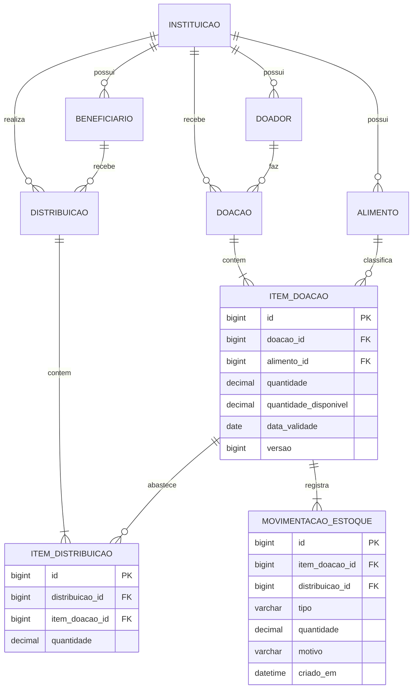

# Arquitetura e decisões de projeto

Este documento explica como o sistema foi construído e por quê. Ele complementa a documentação da 1ª entrega ([documentacao.pdf](documentacao.pdf)).

## Visão geral

A aplicação é uma API REST em Java 21 e Spring Boot, com MySQL. É um **monólito modular**: um único programa, dividido em módulos de negócio que só conversam entre si pelos seus serviços.

```text
com.doacoes
├── cadastro/       Pessoa (abstrata), Doador, Beneficiario, Alimento, Instituicao
├── doacao/         Doacao e ItemDoacao (o lote)
├── distribuicao/   Distribuicao e ItemDistribuicao
├── estoque/        saldo dos lotes, FEFO, descarte e livro de movimentações
└── shared/         erros, paginação, relógio
```

Dentro de cada módulo, as camadas são as de sempre:

| Camada | Papel |
|---|---|
| Controller | Recebe a requisição HTTP, valida o formato e devolve a resposta |
| Service | Aplica as regras de negócio e delimita a transação |
| Repository | Consulta e grava no banco (Spring Data JPA) |
| Model (entidades) | Representa os dados e protege as suas próprias invariantes |

Microsserviços foram descartados: para uma equipe pequena e um domínio deste tamanho, só acrescentariam custo de operação.

## Modelo de dados

O esquema é criado pelos scripts em [`database/migration`](../database/migration), aplicados pelo Flyway na inicialização. O Hibernate apenas confere se as entidades batem com o banco (`ddl-auto=validate`).



### O que mudou em relação aos diagramas da 1ª entrega

O DER e o diagrama de classes divergiam em alguns pontos. A implementação segue o DER, que é o que sustenta o controle por lote descrito no PDF.

| Ponto | Diagrama de classes | DER | Implementado |
|---|---|---|---|
| Validade | Em `Alimento` | Em `ItemDoacao` | Em `ItemDoacao`: cada lote tem a sua |
| Item de distribuição | Aponta para `Alimento` | Aponta para `ItemDoacao` | Aponta para `ItemDoacao`, o lote de origem |
| Documento do doador | `cnpj` | `documento` | `documento` (CPF ou CNPJ) |
| Instituição | Sem ligações | Ligada a doação e distribuição | Ligada a todos os cadastros e lançamentos |
| Unidade de medida | Em `Alimento` e nos itens | Só em `Alimento` | Só em `Alimento` |
| Quantidades | `Double` | | `BigDecimal` / `DECIMAL(12,3)`, sem erro de arredondamento |
| `getSubtotal()` nos itens | Presente | | Removido: não há preço para multiplicar |

Acréscimos ao DER:

- `quantidade_disponivel` e `versao` em `item_doacao`;
- `status`, `motivo_cancelamento`, `criado_em` e `cancelado_em` em `doacao` e `distribuicao`;
- `ativo` nos cadastros;
- `instituicao_id` em `doador`, `beneficiario` e `alimento`;
- a tabela `movimentacao_estoque`.

## Decisões

### Estoque por lote, com saldo e livro de movimentações

Cada item de doação é um **lote**: guarda a quantidade recebida, a validade e o saldo ainda disponível (`quantidade_disponivel`). Toda alteração de saldo grava, na mesma transação, uma linha em `movimentacao_estoque` (RN05). Essa tabela só recebe inserções, e o saldo de um lote é sempre a soma das suas movimentações. Um teste automatizado confere essa igualdade.

| Tipo | Efeito | Quando |
|---|---|---|
| `ENTRADA` | + | Doação registrada |
| `SAIDA` | − | Distribuição registrada |
| `DESCARTE` | − | Baixa por vencimento, avaria ou perda |
| `ESTORNO_ENTRADA` | − | Doação cancelada |
| `ESTORNO_SAIDA` | + | Distribuição cancelada |

O descarte não estava nos requisitos, mas sem ele um alimento vencido ficaria no estoque para sempre: a RN06 proíbe distribuí-lo e nada mais o retiraria.

### Saída por FEFO

Na distribuição o usuário informa o alimento e a quantidade. O sistema retira dos lotes em ordem de validade, **vence primeiro, sai primeiro**, e registra de quais lotes saiu. Lotes sem validade saem por último. Lotes vencidos ficam de fora (RN06). É a decisão que mais contribui para reduzir desperdício, o objetivo ligado ao ODS 2.

### Concorrência

Se dois usuários registram distribuições do mesmo alimento ao mesmo tempo, os dois poderiam ler o mesmo saldo e ambos gastá-lo. Para impedir isso (RN03):

1. a baixa lê os lotes com `SELECT ... FOR UPDATE`, então a segunda transação espera a primeira terminar antes de ver o saldo;
2. cada lote tem um número de versão (`@Version`), que recusa uma gravação baseada em dado desatualizado;
3. o banco tem a restrição `CHECK (quantidade_disponivel >= 0)` como última barreira.

### Doações e distribuições não são editadas nem apagadas

Um lançamento errado é **cancelado**, e o cancelamento gera o estorno no estoque. Assim o histórico (RF07) continua confiável. Uma doação só pode ser cancelada enquanto nada saiu dos seus lotes; se já houve distribuição, é preciso cancelá-la antes.

### Exclusão lógica nos cadastros (RF09)

`DELETE` em doador, beneficiário ou alimento marca o registro como inativo. Ele some das listas de ativos e não entra em novos lançamentos, mas o histórico que o cita permanece íntegro. A reativação desfaz a exclusão.

### Herança sem mudar as tabelas

`Pessoa` é uma classe abstrata com os dados comuns de `Doador` e `Beneficiario`. Ela é mapeada como `@MappedSuperclass`: a herança existe no código, e cada subclasse continua com a sua própria tabela, como no DER.

### Onde cada pilar de POO aparece

| Pilar | Onde |
|---|---|
| Herança | `Doador` e `Beneficiario` estendem `Pessoa`; `EstoqueInsuficienteException` estende `ConflitoException` |
| Polimorfismo | `PessoaService.buscar` reúne doadores e beneficiários em uma lista de `Pessoa` e chama `getDados()` e `getTipoCadastro()` sem saber o que cada um é; `TratadorDeErros` chama `detalhes()` em qualquer `ConflitoException` |
| Composição | `Doacao` contém os seus `ItemDoacao` e `Distribuicao` contém os seus `ItemDistribuicao`: os itens são criados, gravados e removidos junto com o lançamento |
| Encapsulamento | Todos os atributos são privados; o saldo de um lote só muda por `baixar()` e `devolver()`, que recusam valores inválidos |
| Abstração | `Pessoa` é abstrata; os repositórios são interfaces, e o Spring Data fornece a implementação |

### Uma instituição agora, várias depois

Todos os cadastros e lançamentos têm `instituicao_id`, e toda consulta filtra por ele. Enquanto não há login, existe uma única instituição, criada pela migração `V2`. O componente `InstituicaoAtual` é o único ponto que sabe disso: quando houver autenticação, ele passa a ler a instituição do usuário logado e o restante do sistema não muda.

### Datas

"Hoje" é decidido por um relógio único, no fuso `America/Sao_Paulo` (`app.fuso-horario`), e não pelo fuso do servidor. Isso evita que um lote seja considerado vencido algumas horas antes ou depois do correto.

## Segurança e LGPD

Esta versão **não tem autenticação**, como previsto no escopo da 1ª entrega. Ela não deve ser exposta na internet com dados reais antes da próxima fase. O que já foi considerado:

- o documento do beneficiário é opcional, para que a instituição só colete o que realmente precisa;
- toda entrada é validada, e as mensagens de erro não revelam detalhes internos;
- as credenciais do banco vêm de variáveis de ambiente.

## Próximas fases

| Fase | Conteúdo |
|---|---|
| 2 – Segurança | Login, papéis (administrador, operador, leitor), isolamento por instituição a partir do usuário, registro de quem fez cada lançamento, auditoria de acesso a dados de beneficiários |
| 3 – Interface | Aplicação web para uso no celular, painel e alerta de lotes perto do vencimento |
| 4 – Operação | Implantação, monitoramento, backups e relatórios exportáveis |
